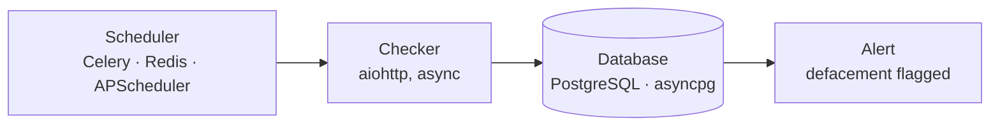

# Defacement Monitoring System

An asynchronous system that watches websites and flags defacement in real time.
Built during my developer internship at **CyberHawkz Intelligence Services** (Jan to Jul 2025, remote).


## What it does

Website defacement is when an attacker changes what a site shows its visitors. This system checks monitored sites on a schedule, stores what it finds, and raises an alert when a site looks defaced, so the owner can react quickly.

## How it works



1. **Scheduler:** Celery workers, Redis and APScheduler trigger the checks automatically.
2. **Checker:** pages are fetched asynchronously with `aiohttp`, so many sites can be checked at the same time without blocking.
3. **Database:** results and history are stored in PostgreSQL through `asyncpg`.
4. **Alert:** a suspected defacement is flagged in real time.

> **[FILL IN]** Add 2 or 3 lines on *how a defacement is detected* (for example, comparing a page against a saved baseline, or checking for specific content) and *how the alert is delivered* (dashboard, email, etc.). These are the details a reader will look for first.

## Features

- Asynchronous checking for real-time threat detection
- Automated web scraping and scheduling (Celery, Redis, APScheduler)
- Stored history of checks in PostgreSQL
- Security hardening: XSS prevention and input validation
- Performance tuning: caching and query optimisation

## Tech stack

| Area | Tools |
|---|---|
| Backend | Django, Django REST Framework |
| Async | aiohttp, asyncpg |
| Scheduling | Celery, Redis, APScheduler |
| Database | PostgreSQL |
| Platform | Linux |

## Getting started

> **[FILL IN]** The steps below are a typical Django setup. Change them to match your repo.

```bash
# 1. Clone and enter the project
git clone https://github.com/vishal-038/defacement.git
cd <repo-name>

# 2. Create a virtual environment and install dependencies
python3 -m venv .venv
source .venv/bin/activate
pip install -r requirements.txt

# 3. Configure environment variables (database URL, Redis URL, secret key)
cp .env.example .env

# 4. Set up the database
python manage.py migrate

# 5. Start the services (each in its own terminal)
python manage.py runserver
celery -A <project_name> worker -l info
```

## Security

- Input validation on data entering the system
- Protection against cross-site scripting (XSS)
- Never commit real secrets. Keep them in `.env`, which is listed in `.gitignore`

## Performance

- Caching to avoid repeating work
- Query optimisation to keep database calls fast as history grows
- Async I/O so slow sites don't hold up the rest

## Also built during the internship

A **Quiz Management App** with role-based access, PostgreSQL, REST APIs and a bulk mailing system for sending coupon codes and notifications.

## What I learned

- Designing async Python services that stay responsive under load
- Scheduling and background jobs with Celery, Redis and APScheduler
- Treating security and performance as part of the design, not an afterthought

## Author

**Vishal**, M.Tech in Computer Science and Engineering
[LinkedIn](https://www.linkedin.com/) · [GitHub](https://github.com/) · vishaal03.it@gmail.com